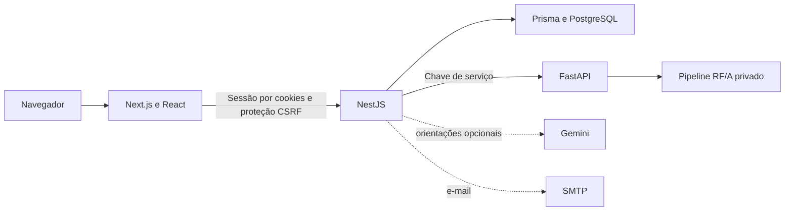

# BurnoutSense

O BurnoutSense é um projeto de TCC de Engenharia da Computação da FACENS. A
plataforma acompanha a rotina universitária e investiga quanto desse contexto
ajuda a estimar o escore global da ESB-eu, a Escala de Burnout em Estudantes
Universitários.

## O que a aplicação faz

- Cadastro, login, recuperação de senha e acesso ao histórico da própria conta.
- Formulário inicial com **22 variáveis contextuais** sobre as últimas quatro semanas.
- **Estimativa experimental de 0 a 4** pelo Random Forest do conjunto A
  (`rf-a-candidate-v1`). Os **14 itens ESB-eu** são opcionais na aplicação e
  calculam separadamente a média global observada e as três dimensões. No
  treinamento, esses itens definem o desfecho e ficam fora dos preditores.
- Check-ins com calendário, histórico e gráficos. Quando habilitada, a ponte
  experimental agrega observações elegíveis na janela de 28 dias e atualiza cinco
  entradas do RF/A. A revisão guiada permite confirmar mudanças no contexto.
- Dicas gerais com Gemini, quando configurado, e lembretes por e-mail mediante
  adesão no perfil. O horário padrão do lembrete é 12h em `America/Sao_Paulo`,
  para quem ainda não registrou o check-in do dia.

## Tecnologias e arquitetura



O frontend usa Next.js, React e TypeScript. Em Python, o FastAPI valida o
contexto e executa o pipeline scikit-learn. O NestJS persiste
a avaliação e a versão do modelo. A integração opcional com o Gemini recebe o
percentual do índice e instruções para gerar orientações gerais; respostas e
notas ficam na aplicação.

## Início rápido

Use Git, Node.js 22 (versão indicada nos subprojetos), npm, pnpm 9.15.0,
PostgreSQL de desenvolvimento e Python 3.12 em ambiente virtual compatível
com o pacote RF/A privado.

```powershell
git clone https://github.com/MiltonPenha/BurnoutSense.git
cd BurnoutSense
```

1. Receba da equipe os quatro arquivos do RF/A e valide a origem e os hashes. O
   pacote fica fora do Git e **o CSV da pesquisa não é necessário para inferência**.
   [Instalação do RF/A](docs/getting-started/RF_A_TEAM_SETUP.md)
2. Configure o PostgreSQL local e inicie FastAPI, NestJS e Next.js conforme o guia.
   Os modelos de configuração estão em [IA](ai-service/.env.example),
   [backend](backend/.env.example) e [frontend](frontend/.env.example).
   [Executar o fluxo diário](docs/getting-started/DAILY_TRACKING_LOCAL_SETUP.md)
3. Abra [localhost:3000](http://localhost:3000) com os serviços ativos e use uma
   conta fictícia de desenvolvimento. Antes da primeira avaliação, confirme
   `random_forest` e `rf-a-candidate-v1` no `GET /v1/model`. No FastAPI, `/health`
   verifica o processo, e `/ready`, autenticado, verifica a disponibilidade do modelo.

Veja os [comandos de teste](docs/getting-started/DEVELOPMENT_GUIDE.md#testes). A homologação com navegador
e banco usa ambiente e contas isolados. Mantenha credenciais, respostas de pesquisa
e artefatos treinados fora do Git.

## Limitações científicas

O percentual é a posição da estimativa na escala (`escore / 4 × 100`). Um escore
estimado de 2 equivale a 50% da escala. A aplicação não fornece probabilidade de
burnout nem diagnóstico. O RF/A e a adaptação dos check-ins têm finalidade
exploratória e ainda não têm validação independente em novos participantes.
As avaliações ficam vinculadas à conta e não alimentam o treinamento automaticamente.

## Documentação

- [Índice da documentação](docs/README.md)
- [Demonstração híbrida para a banca](docs/getting-started/DEMO_BANCA.md)
- [Implantação online](docs/deployment/DEPLOY_BURNOUTSENSE_ONLINE.md)
- [Protocolo científico v2 congelado](docs/ML_OPTIMIZATION_V2_PROTOCOL.md)
