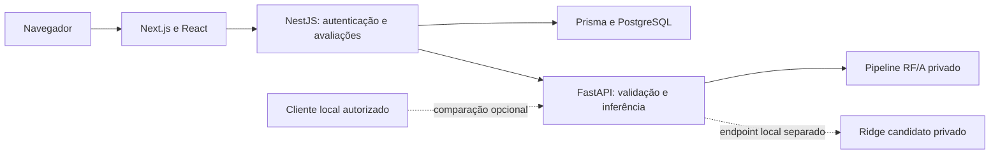

# BurnoutSense

Plataforma acadêmica desenvolvida no TCC de Engenharia da Computação da FACENS
para acompanhar a rotina universitária e investigar a estimativa do escore
global ESB-eu a partir de informações contextuais.

A aplicação utiliza **22 variáveis contextuais** e apresenta uma estimativa
experimental contínua de **0 a 4**. Os 14 itens ESB-eu definem o desfecho nos
estudos e podem ser respondidos opcionalmente na aplicação para calcular uma
medição observada separada. Eles nunca são preditores do modelo.

A interface apresenta esse escore também como **posição percentual na escala**:
`escore / 4 * 100`. Por exemplo, 2 de 4 corresponde a 50% da escala, não a 50%
de probabilidade de burnout. API, banco, treinamento e métricas mantêm 0–4.
O acompanhamento começa com um contexto completo sobre as últimas quatro
semanas. Os check-ins descrevem dias específicos e podem ser retroativos. Na
[integração experimental](docs/DAILY_TRACKING.md), os dias registrados dentro da
janela de 28 dias atualizam parte do contexto sem alterar o treinamento do RF/A.

O BurnoutSense não fornece diagnóstico, classificação clínica, porcentagem de
risco ou confiança individual. Os modelos ainda não possuem validação
independente em novos participantes.

## Funcionalidades implementadas

- Cadastro, login e acesso autenticado às informações da própria conta.
- Formulário contextual com tipos e alternativas fornecidos pelo serviço de IA.
- Check-in diário em duas etapas, com seleção de data e histórico separado dos índices.
- Estimativa pelo Random Forest/A e identificação da versão usada.
- Medição direta ESB-eu opcional, com média global e três dimensões.
- Persistência de avaliações, dashboard, histórico paginado e gráfico de evolução.
- Perfil e preferências de apresentação.
- Endpoints de saúde, prontidão, esquema e métricas agregadas do serviço Python.

Novas avaliações não são incorporadas automaticamente ao treinamento.

## Arquitetura



| Componente | Responsabilidade |
|---|---|
| Next.js, React e TypeScript | App Router, interface, formulários, dashboard e histórico |
| NestJS | API autenticada, autorização por usuário e integração HTTP com a IA |
| Prisma e PostgreSQL | Persistência de contas e avaliações |
| Python, FastAPI e scikit-learn | Contratos, cálculo observado e inferência do pipeline |

O backend envia apenas o contexto necessário à IA, sem identificador da conta.
O CSV de pesquisa não participa da inferência e não é distribuído pelo Git.

## Modelos e limites de uso

**RF/A (`rf-a-candidate-v1`)** é o modelo oficial do fluxo atual da aplicação,
mantendo caráter científico experimental. O pacote treinado é privado e deve
ser recebido separadamente de um responsável autorizado.

**Ridge** é um candidato separado para comparação local. A funcionalidade
shadow é desativada por padrão, exige configuração explícita, autenticação e
ambiente local/teste. Não altera a resposta RF/A, não aparece como opção para
estudantes e não grava previsões no banco. Veja [Ridge shadow](docs/RIDGE_SHADOW.md).

As versões científicas e seus protocolos são preservados. Métricas e métodos
estão nos documentos técnicos; não representam precisão individual ou validação clínica.

## Estrutura

```text
frontend/             Interface Next.js/React em TypeScript estrito
backend/              API NestJS, Prisma e migrações
ai-service/app/       FastAPI e carregadores de modelos
ai-service/training/ Esquemas, pipelines e procedimentos de pesquisa
ai-service/tests/    Testes Python com fixtures fictícias
docs/                Contratos, ambiente, protocolos e guias
```

## Pré-requisitos

- Git, Node.js compatível com Next.js 16 (`>=20.9.0`), npm e pnpm compatível
  com o lockfile do backend.
- PostgreSQL de desenvolvimento, separado de qualquer banco de produção.
- Python 3.12 em ambiente virtual. Referência auditada: CPython 3.12.14,
  Windows AMD64; bibliotecas devem coincidir com o pacote recebido.
- Pacote RF/A privado e chave própria para comunicação backend → FastAPI.

Sem o pacote, `/health` pode responder, mas prontidão e previsão ficam
indisponíveis. Não há pontuação alternativa ou treinamento automático.

## Instalação local

```powershell
git clone https://github.com/MiltonPenha/BurnoutSense.git
cd BurnoutSense
```

Para uma entrega em revisão, selecione a branch indicada no Pull Request antes
de instalar. Preserve alterações locais ao atualizar; não use reset ou clean.

### Serviço de IA

Siga o [guia RF/A da equipe](docs/RF_A_TEAM_SETUP.md) para criar o ambiente,
receber os quatro arquivos privados e conferir seus hashes. A referência de
reprodução está em [ambiente v2](docs/ML_OPTIMIZATION_V2_ENVIRONMENT.md).

Configure as variáveis abaixo no processo ou em arquivo privado externo.
[`ai-service/.env.example`](ai-service/.env.example) não provisiona modelo ou chave
automaticamente. Não carregue pickle/joblib desconhecido nem atualize bibliotecas
silenciosamente.

### Backend e PostgreSQL

```powershell
cd backend
pnpm install --frozen-lockfile
if (-not (Test-Path .env)) { Copy-Item .env.example .env }
```

Configure um banco **de desenvolvimento** e substitua os segredos de exemplo.
Em banco novo ou de desenvolvimento previamente conferido:

```powershell
pnpm exec prisma generate
pnpm exec prisma migrate deploy
pnpm start:dev
```

As migrações não importam o CSV de pesquisa. Não execute reset nem aponte esses
comandos indiscriminadamente à produção. Para bancos existentes, consulte
[integração e rollback](docs/ETAPA_10_INTEGRATION.md).

### Frontend

Em outro terminal, a partir da raiz:

```powershell
cd frontend
npm ci
if (-not (Test-Path .env.local)) { Copy-Item .env.example .env.local }
npm run dev
```

### Variáveis principais

| Serviço | Configuração |
|---|---|
| Frontend | `NEXT_PUBLIC_API_URL=http://localhost:3001` |
| Backend | `DATABASE_URL`, `JWT_ACCESS_SECRET`, `JWT_REFRESH_SECRET`, `PORT=3001`, `FRONTEND_URL=http://localhost:3000` |
| Backend → IA | `AI_SERVICE_URL=http://127.0.0.1:8000`, `AI_SERVICE_API_KEY` |
| FastAPI RF/A | `BURNOUTSENSE_MODEL_DIR`, `BURNOUTSENSE_DATASET_VERSION=rf-a-candidate-v1`, `BURNOUTSENSE_TRUST_LOCAL_MODEL=true`, `BURNOUTSENSE_EXPERIMENTAL_MODEL=true`, `BURNOUTSENSE_API_KEY` |
| Ridge opcional | `BURNOUTSENSE_SHADOW_RIDGE_ENABLED=false` por padrão; demais condições no [guia](docs/RIDGE_SHADOW.md) |

As duas variáveis de chave da comunicação IA devem ter o mesmo segredo local,
com pelo menos 24 caracteres. Nunca use `NEXT_PUBLIC_` para segredos.
SMTP e lembretes são opcionais para o teste de previsão.

### Iniciar e conferir

No terminal Python configurado, dentro de `ai-service`, com `$Python` apontando
ao executável do venv e as variáveis RF/A definidas:

```powershell
& $Python -B -m uvicorn app.main:app --host 127.0.0.1 --port 8000 --no-access-log
```

Mantenha PostgreSQL, FastAPI, NestJS e Next.js ativos. Acesse
`http://localhost:3000`; backend em `http://localhost:3001`; Swagger em
`http://127.0.0.1:8000/docs`. `/health` verifica o processo; `/ready` exige
`X-API-Key` e confirma o carregamento RF/A. `/v1/examples` fornece entradas fictícias.

## Testes

Execute no respectivo subprojeto, com dependências instaladas:

```powershell
# ai-service
& $Python -B -m unittest discover -s tests
& $Python -B -m unittest discover -s tests -p test_ridge_shadow.py
& $Python -m pip check

# backend
pnpm test --runInBand
pnpm build

# frontend
node --test tests/esbeu-form.test.mjs
npm run build
```

Testes unitários usam fixtures fictícias. A homologação com navegador e banco tem
preparação própria na [Etapa 10](docs/ETAPA_10_INTEGRATION.md); não a aponte ao banco
da aplicação.

## Segurança e privacidade

- Dados de pesquisa, questionários preenchidos, modelos treinados e relatórios
  privados permanecem fora do Git; a base real não é versionada.
- `.gitignore` não protege arquivo já rastreado: revise o conteúdo e o índice.
- Avaliações são isoladas por conta; a comunicação de serviço é autenticada.
- Não há envio de respostas a APIs externas de geração de texto na previsão.
- Hash confirma integridade, não confiança ou anonimização do modelo.
- O Ridge não é habilitado automaticamente em produção nem substitui o RF/A.

## Documentação

- [Desenvolvimento local](DEVELOPMENT_GUIDE.md)
- [Contrato NestJS e persistência](BACKEND_INSTRUCTIONS.md)
- [API Python e treinamento](ai-service/README.md)
- [Instalação e pacote RF/A](docs/RF_A_TEAM_SETUP.md)
- [Procedimento RF/A](docs/RF_A_EXPERIMENTAL_CANDIDATE.md)
- [Ridge shadow](docs/RIDGE_SHADOW.md)
- [Protocolo v2 congelado](docs/ML_OPTIMIZATION_V2_PROTOCOL.md)
- [Modelo histórico v1](ai-service/MODEL_CARD.md)
- [Métricas históricas](docs/ESBEU_METRICS.md)
- [Integração, migrações e rollback](docs/ETAPA_10_INTEGRATION.md)
