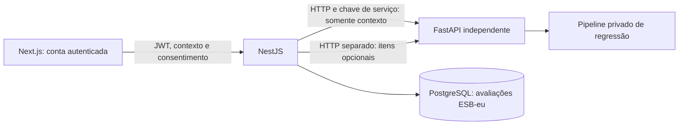

# Etapa 10 — integração ESB-eu

## Arquitetura e fluxo



O treinamento continua local e separado da aplicação. O CSV final de pesquisa não é lido em runtime, enviado pelo navegador ou importado para PostgreSQL. As avaliações novas da aplicação não atualizam automaticamente a base nem o modelo. Usuário, e-mail, consentimento e identificadores da conta não são encaminhados ao FastAPI.

O modelo estima somente o escore geral, contínuo de 0 a 4, usando 22 contextos. Os 14 itens opcionais geram a medição observada e suas três dimensões em chamada separada. Não entram na previsão. Não existem faixas diagnósticas, confiança percentual, recorte silencioso ou pontuação alternativa.

## Banco e consentimento

A migração `20261030100000_add_esbeu_assessments` adiciona uma tabela própria, vinculada à conta por chave estrangeira. Não altera nem converte as tabelas históricas. A nova tabela armazena contexto, itens opcionais, escore estimado, escores observados opcionais, modelo, identificador do artefato, versão da base, contrato, formulário e consentimento com data do servidor. Há restrições SQL de domínio dos escores, elegibilidade e completude do resultado observado.

`modelVersion` é o SHA-256 do artefato, um identificador de integridade, sem parâmetros aprendidos ou pipeline serializado. `datasetVersion` identifica a coleta usada no treinamento, não os registros operacionais desta tabela.

O consentimento de uso `esbeu-app/1` descreve armazenamento na conta, exclusão, ausência de incorporação automática ao treinamento, ausência de envio a IA generativa externa e limites da estimativa. É uma autorização de uso da aplicação, distinta do TCLE da pesquisa; não se afirma aprovação institucional com esse checkbox. O servidor exige consentimento, idade mínima de 18 anos e matrícula confirmados, sem preseleção no formulário.

As avaliações são imutáveis: não há PATCH. Um novo contexto gera outro registro. DELETE remove uma avaliação do próprio usuário; exclusão da conta remove suas avaliações por cascade. Listas retornam somente resumos, 25 registros por página; contexto e itens são expostos apenas no detalhe do dono autenticado. Uma conta não pode consultar, excluir ou usar o cursor de outra conta. Não há rota de listagem global.

## Contrato HTTP do backend

Todas as rotas exigem JWT:

| Rota | Comportamento |
|---|---|
| GET `/esbeu-assessments/form` | Esquema público canônico e texto/versionamento do consentimento |
| POST `/esbeu-assessments` | Valida, consulta a IA e persiste o resultado completo |
| GET `/esbeu-assessments` | `{items, nextCursor}`, até 25 resumos |
| GET `/esbeu-assessments?cursor=<id>` | Próxima página do dono |
| GET `/esbeu-assessments/:id` | Detalhe privado do dono |
| DELETE `/esbeu-assessments/:id` | Exclusão do dono, HTTP 204 |

POST recebe `context` (exatamente os 22 campos), `consent=true`, `adult=true`, `enrolled=true`, `consentVersion="esbeu-app/1"` e opcionalmente `items` (todos os 14 itens inteiros 0–4). Omitir items representa ausência de medição direta; null ou objeto incompleto são rejeitados. Não envie userId: o dono vem do JWT. Não envie resultados calculados pelo cliente; os escores vêm do FastAPI.

400 indica contrato da aplicação inválido; 401, autenticação; 404, registro inexistente ou pertencente a outra conta; 422, contexto/itens inválidos ou estimativa fora do domínio; 502, resposta incompatível da IA; 503, indisponibilidade, falha de persistência ou criação desativada. Corpos nessa rota têm limite de 256 KiB, com erros de parsing/validação sanitizados. Respostas e erros usam no-store. Não se registram payloads ou exceções Prisma contendo argumentos de consultas.

## Interface

`/registro` deriva perguntas, alternativas, tipos, instruções e limites de `form_schema.py` via FastAPI e NestJS. Não há cópia manual de categorias. Campos iniciam vazios e consentimentos desmarcados; zero e “Não se aplica” permanecem distintos. Respostas ficam no formulário em memória, sem armazenamento em localStorage ou telemetria. Autenticação requer backend configurado: não há login de demonstração ou salvamento fictício.

`/dashboard` distingue ESB-eu estimada e observada, apresenta as dimensões somente quando medidas e mostra até 25 avaliações em ordem de registro. Janelas das últimas quatro semanas podem se sobrepor; o gráfico não indica previsão futura. A tabela científica mantém R² negativo e separa métricas agregadas da confiança de uma pessoa. `/historico` pagina avaliações; o detalhe apresenta respostas, versões e exclusão confirmada. Estados vazio, carregando, erro e indisponibilidade são explícitos. Não se exibem resultados antigos como se fossem ESB-eu.

## Implantação revisável

1. Faça backup do banco atual em local privado fora do repositório e confira `pnpm exec prisma migrate status`. Não use reset ou db push sobre dados existentes. Se o banco não possui histórico Prisma compatível, reconcilie/baseline as migrações antes de deploy.
2. Instale as dependências congeladas do backend. Express 4.22.1 agora é dependência direta porque `main.ts` o importa; é a mesma versão já usada transitivamente no lockfile, sem atualização geral de bibliotecas.
3. Aplique as migrações revisadas no ambiente desejado: `pnpm exec prisma migrate deploy`; depois `pnpm prisma:generate` e `pnpm build`.
4. Inicie o FastAPI em processo próprio com configuração e modelo privados externos ao repositório. Verifique `/ready` com chave de serviço e o modelo/base esperados.
5. Configure NestJS: `AI_SERVICE_URL`, `AI_SERVICE_API_KEY`, `DATABASE_URL`, segredos JWT, `FRONTEND_URL` e `ESBEU_ASSESSMENTS_ENABLED=true`. Mantenha os serviços em rede interna/TLS quando estiverem em hosts distintos. A chave de IA nunca vai para NEXT_PUBLIC ou navegador. Mantenha lembretes desativados até revisar o fluxo de notificações.
6. Configure `NEXT_PUBLIC_API_URL` **antes do build** do Next.js e execute `npm ci`, `npm run lint`, `npm run build`. Essa URL é embutida no frontend; mudar só o ambiente de `next start` não a altera. Execute `npm start`.
7. Homologue com uma conta de teste e respostas artificiais: contexto sem itens, contexto com 14 itens, histórico, detalhe, exclusão, segunda conta e IA offline. Não use participantes reais em testes ou capturas de tela de revisão.

A migração no banco operacional não é executada automaticamente pelo agente. O teste integrado usa um cluster novo e descartável, distinto do DATABASE_URL da aplicação.

## Testes reproduzíveis

IA: `python -m unittest discover -s tests -v` e `python -m compileall -q app training tests`, em `ai-service` com requirements-dev e Python 3.12.

Backend: `pnpm test --runInBand`, `pnpm build` e ESLint sem --fix. `prisma validate` precisa de um DATABASE_URL definido, mesmo sem abrir conexão; uma URL fictícia local serve à validação sintática.

Frontend: `node --test tests/esbeu-form.test.mjs`, `npm run lint`, `npm run build`.

Homologação isolada, a partir da raiz, em Windows com PostgreSQL instalado:

```powershell
python backend/test/verify-esbeu-e2e.py `
  --private-env CAMINHO_ENV_PRIVADO `
  --output NOVA_PASTA_EXTERNA `
  --pg-bin 'C:/Program Files/PostgreSQL/18/bin' `
  --node 'C:/Program Files/nodejs/node.exe'
```

O script requer httpx e python-dotenv (requirements-dev do serviço), dependências Node instaladas e um artefato local de origem conhecida. Cria seu próprio cluster PostgreSQL com autenticação trust **somente em loopback**, portas temporárias e dados artificiais. Preserva uma linha histórica artificial ao aplicar a migração, verifica autenticação real, permissão entre contas, consentimento, validação, paginação, disponibilidade, exclusão e rollback. Encerra os processos e o cluster; não usa o DATABASE_URL herdado nem lê CSV. Logs privados e arquivos do cluster ficam na pasta externa para revisão e podem ser descartados depois.

Para incluir QA no Edge headless com Playwright instalado localmente, acrescente `--playwright-module CAMINHO_PLAYWRIGHT/index.mjs`. Nenhuma dependência de navegador é adicionada à aplicação de produção. O teste bloqueia requests externos e verifica criação, exclusão, histórico e ausência de overflow em tela de 390 px, salvando imagens com dados artificiais.

## Rollback

Defina `ESBEU_ASSESSMENTS_ENABLED=false` e reinicie o backend para bloquear novas avaliações/formulário, mantendo leitura/exclusão do histórico. Em incidente, retire a navegação para criação ou mostre o erro de disponibilidade já previsto. Não reative o classificador antigo como fallback. A migração é aditiva: mantenha a tabela e os registros durante rollback de código; não aplique DROP TABLE automaticamente.

Para retirar também leitura, suspenda o serviço conforme o procedimento de implantação da equipe. Qualquer rollback para uma versão anterior aos contratos ESB-eu deve considerar os três serviços juntos; não transforme escores contínuos em categorias antigas. A Etapa 10 não refaz treinamento, altera os resultados científicos ou publica artefatos privados.
